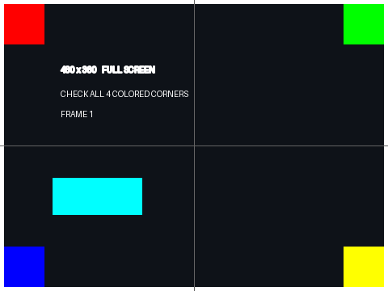

# AULA Neos75 全屏补丁与键盘小组件

把官方自定义媒体页从右侧320×320区域扩展为 **480×360全屏**，隐藏左侧状态条。2026-11-02已在一台Neos75上刷入并逐字节回验，用户确认：**图片和GIF都全屏正常**。



上图是生成的验收素材，非屏幕实拍。实机确认见 [验收记录](evidence/user-acceptance.json)。

## 下载可执行程序

**v1.4.0 桌面新版**：简洁的玻璃风格界面，一个程序包含“一键全屏”和“小组件”。自动读取本机备份、匹配补丁并校验；组件可搜索添加、移除、排序、保存并自动分页。新增天气、Codex 状态、组件固定页与原厂翻页按钮。四平台下载，详见 [新版使用说明](docs/desktop-glass.md) 与 [更新内容](docs/release-v1.4.0.md)。

[Windows / Mac / Linux 下载](https://github.com/hacker1232345/neos75-fullscreen/releases/latest)。程序内置运行环境；Mac 支持 macOS 15+，Linux x64 以 Ubuntu 22.04/24.04 桌面为目标。Mac/Linux USB/DFU 尚待真机验收。

v1.2.0 在原有全屏补丁之上加了一层可选的**屏幕部件**：把电脑的时钟、CPU、内存、网络等状态实时画成480×360图片推到屏幕上。补丁按备份哈希自动选择，**无需勾选“无验证”**。没有原始备份时，先点“从设备读取备份”；也可选择已有备份离线识别。Issue #1构建标明“离线适配，待实机验收”。未知构建默认拒绝，强制模式仍默认关闭。详见 [可执行程序说明](docs/desktop-release.md)。

**六个原厂界面不等于六个独立图片槽。** 当前上传仍会替换同一个自定义媒体区；本版支持电脑端组件轮播/固定页与原厂前后翻页，没有实现图片和组件分别保存在两个原厂界面。详见 [天气、Codex 与切页说明](docs/widget-sources.md)。

## 补丁链

固件配置是多层叠加的，链式衔接由代码区SHA256精确决定，不做“看起来像就套用”的推断：

| 层 | 配置 | 从 → 到 | 改动 | 验证状态 |
| --- | --- | --- | --- | --- |
| 第一层 | `firmware/fullscreen.patch.json` | 原版 `66679ff2` → 全屏 `cdd6334d` | 27 字节 | 实机验收 |
| 第二层 | `firmware/profiles/clean.patch.json` | 全屏 `cdd6334d` → 全屏+清爽 `8465dd63` | 13 字节 | 实机刷入并逐字节回验 |
| 另一条链 | `firmware/profiles/issue1.patch.json` | 原版2 `74f2fa47` → 全屏2 `9093f898` | 27 字节 | 离线通过，待实机验收 |

一个「原版」备份会自动连打两层到链末；如果设备已经在第一层，程序识别为 `upgradeable` 并**只补剩余那层**。第二层只改13个字节：

| 地址 | 文件偏移 | 旧 → 新 | 作用 |
| --- | --- | --- | --- |
| `0x3453c` | `0x2c53c` | `f2f72cf9` → `00bf00bf` | 上传开始时不再隐藏全屏图片对象，消除上传期间满屏黑 |
| `0x345aa` | `0x2c5aa` | `09f06bff` → `00bf00bf` | 跳过进度环绘制调用 |
| `0x345cf` | `0x2c5cf` | `f6b831` → `f2dc51` | 上传收尾阈值 3000ms → 1500ms（刷新 33s → 3~4s） |
| `0x3e54a` | `0x3654a` | `ff` → `00` | 覆盖层容器初始化即隐藏 |
| `0x3e69c` | `0x3669c` | `30` → `00` | 覆盖层标签初值串 `"0%\n"` 清空 |

第二层触及的两个4KB扇区是 `0x34000`、`0x3e000`。

## 屏幕部件（可选显示）

`dashboard/` 把电脑状态画成 480×360 baseline JPEG 推到屏幕上。17 个可选部件：

| 分组 | 部件 |
| --- | --- |
| 时间 | `clock_big` 超大时钟、`date` 日期 |
| 性能 | `cpu`、`mem`、`gpu`、`temp` 温度、`history_cpu` 折线、`top_proc` 最占进程 |
| 存储 | `disk` 磁盘剩余 |
| 网络 | `net` 上下行速率、`ip` 地址 |
| 系统 | `host` 主机名、`uptime` 运行时长 |
| 电源 | `battery` 电池、`volume` 音量 |
| 生活 / 工作 | `weather` 天气、`codex` Codex 状态 |

预设：`minimal` / `default` / `full` / `performance` / `network`，也可以任意勾选组合。

```sh
python dashboard/render.py --list                    # 列出部件注册表
node   dashboard/push.js info                        # 只读查询屏幕
node   dashboard/push.js dry --preset full           # 离线构造传输计划，不打开USB
node   dashboard/push.js once  --widgets clock_big,cpu,mem,net
node   dashboard/push.js loop  --preset default --interval 3000
```

采样走 `dashboard/live_state.ps1`（全 CIM，稳态约 0.62 秒/次，重项按相位分摊缓存）。渲染走 `dashboard/render.py`（Pillow，`progressive=False`，超字节上限时二分降质量）。推送走 `dashboard/push.js`，协议与 `wallpaper/screen_wallpaper.js` 一致。

## 日常使用

已经刷入本补丁的设备，重新连接官方程序后，在第5页导入原图片或GIF即可。旧320×320转换素材需重新导入。非480×360原图的缩放/裁切由官方程序控制。

要显示电脑状态，用桌面程序的「屏幕部件」页，或直接跑上面的 `push.js`。同一时刻只能有一个上传者，连续推送前请关闭官方程序的上传任务。

## 内容

- `firmware/fullscreen.patch.json`：第一层补丁；精确旧/新字节、地址、原始和目标SHA256；仅改变27个载荷字节。
- `firmware/profiles/clean.patch.json`：第二层补丁（全屏+清爽），挂在第一层之上，只改13字节。
- `firmware/profiles/issue1.patch.json`：Issue #1构建重新定位后的补丁；以精确代码哈希自动选择，同样只改27字节。
- `tools/build_fullscreen.py`：纯Python标准库生成器；按哈希识别镜像所处层，自动连打剩余层，并保留自己的末尾4KB数据。
- `tools/mcu_dfu.js`、`mcu_flash_live.js`：MCU DFU传输及带备份/回验的本机专用刷写工具。
- `wallpaper/`：官方壁纸协议的JPEG上传工具和差分测试。GIF全屏由补丁支持，日常GIF导入使用官方程序；本JPEG工具不提供通用GIF转换。
- `dashboard/`：屏幕部件模块（采样、渲染、推送、离线自测）。
- `examples/`：480×360边框图和两帧GIF。
- `evidence/`、`docs/`：实机回验、仿真结果、验收及纠错复盘。

完整设备备份、原厂固件和生成后的整片镜像由设备持有人本地保存。本仓库发布补丁数据及工具，不包含个人设备完整Flash转储。

## 适配范围

目前自动识别以下两种已知构建，以前487424字节SHA256匹配，不按后台版本号或VID/PID选择：

| 构建 | 原版代码前缀SHA256 | 验证状态 |
| --- | --- | --- |
| 原验证构建 | `66679ff2cb06ab5a5e47673f679e14e68bf2082fb6401b3808ca58d7f2e1a40c` | 图片/GIF已实机验收；清爽层已实机刷入回验 |
| Issue #1构建 | `74f2fa47a76206526ade19dc66c398fa18dbfecf779c008b4470cf63706a726b` | 离线定位、ARM仿真、刷写模型通过；待实机验收 |

已补丁的中间态代码（全屏 `cdd6334d`）与链末代码（全屏+清爽 `8465dd63`）也会自动识别：前者报“可继续升级”，后者报“已是链末”，都不需要重复刷写。原验证构建参考备份的完整SHA256为：

```
c69c38b02841c533db44e8b058a6b86d4a0e816d2bb6ce95cd2b1d5d6927016d
```

备份长度491520字节，映射0x8000..0x80000。程序严格核对前487424字节代码区域SHA256与全部补丁原字节，末尾4096字节现场数据保持原样。整片哈希因现场数据不同可能变化。其他代码构建必须重新定位，不能仅凭型号相同套用。

## 安装与离线验证

### 无验证，直接打补丁（v1.1.2）

在“设备与补丁”或“固件维护”页勾选同名选项；两页共用当前选择，重启后默认关闭。勾选后跳过版本哈希和补丁旧字节检查，将20条补丁记录的目标字节写到固定偏移；未知固件的实际改动字节数可能不等于27。v1.1.3对已知构建仍自动选择其对应地址，未知构建强制模式使用原验证构建地址，不会搜索或自动适配任意新固件。此模式不代表已经适配或能正常启动。

仍要求完整491520字节备份，保留补丁记录以外的字节、前256字节和最后4096字节。生成目标必须与当前备份按同一模式重建的结果完全一致，刷写只处理四个8KB保护组中的差异组，保留现场扇区检查、写后回验和恢复。输出不能覆盖原始备份。

命令行生成：`python desktop/app.py --build 原始备份.bin --out 全屏固件.bin --force`。随后维护也须传入同一 `--force`，如 `python desktop/app.py --maintain flash --baseline 原始备份.bin --target 全屏固件.bin --force --yes`。不带 `--force` 的行为保持严格验证。纯Python生成器也支持 `--force`。

需要Node.js及Python 3。无需接设备即可运行默认测试：

```sh
npm install
npm test
python -m unittest discover -s tests -v
```

用程序读取并确认代码版本匹配的原始备份生成目标（这一步不连接设备）：

```sh
python tools/build_fullscreen.py --source /path/to/mcu-before-fullscreen.bin --out /path/to/mcu-fullscreen-live-v1.bin
```

输出491536字节（含16字节DFU后缀），参考备份对应的目标SHA256：

```
3c922e809dcfac1c35ad8f1f8caebcfc999bf6475a3e6fa22fd18c5d85a4f6e5
```

若末尾现场数据与参考备份不同，生成目标的完整SHA256也会不同；以本机生成结果和代码区域校验为准，刷写前会逐字节重建比对，确保末尾数据来自本机备份。

需运行固件模型测试时，把匹配备份放仓库根目录并以默认输出路径生成，再执行 `npm run test:device-image`；这些文件已加入gitignore。ARM指令仿真额外需要 `pip install -r requirements-dev.txt`，然后执行 `python tools/test_arm_emulation.py`。仿真不覆盖LCD、硬件JPEG和真实堆。

## 刷写和恢复

刷写会修改设备固件。请先阅读 [维护说明](docs/maintenance.md)。本工具按上述两种已知构建选择补丁，不能作为任意Neos75的一键通用升级器。`plan`和`verify`也可能使设备进入DFU，日常只查询屏幕可用 `node wallpaper/screen_wallpaper.js status`。

已验证的写法是每个4096B块独立SET_ADDRESS并以DNLOAD block=2写入。4个8KB保护组为0x10000、0x32000、0x36000、0x42000，包含邻居数据，每组写后回验，最终再次回验。不能套用旧UI连续块算法。

## 验证与限制

实机四组回验PASS，退出DFU后应用回报480×360；静态JPEG和2帧动画传输完成，用户确认两种均全屏正常。长GIF帧率、复杂素材及断电保留尚未验收。LVGL堆384KB，全屏共享缓冲约337.5KB，剩余空间需关注。

复盘与五列风险表见 [项目复盘](docs/retrospective.md)。屏幕部件走的是官方媒体页的JPEG通道，不需要无线协议；温度一类取不到的值显示 n/a，不做假数据。

## 来源与许可

原创补丁工具和文档采用MIT许可；品牌、原厂固件及官方前端方法的权利属于原权利人。官方方法摘录仅用于协议差分验证，详见 [第三方说明](THIRD_PARTY_NOTICES.md)。本项目与AULA官方无隶属关系。
