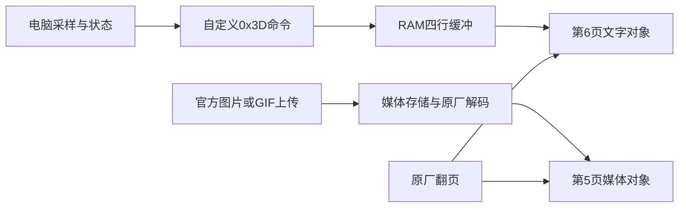

# Neos75 屏幕固件：数据存储、绘制和原生翻页研究

日期：2026-11-03。状态：**离线实验通过，未刷机、未真机验收。**

本次交付是 [第 6 页原生组件候选及复现工具](../experimental/native-pages/README.md)。代码位于 `research/native-page6`，稳定 v1.4.0 未包含本实验。研究对象是屏幕 MCU，不是地址基址为 `0x08000000` 的键盘主控。

## 结论与实现范围

原厂六页由页面表、各页对象和切入回调组成，可以替换其中一页的创建与更新函数来赋予新功能。上传图片/GIF仍走一个媒体页，不能仅靠发送“下一页”实现六份独立媒体。本候选将 **第 5 页继续用于媒体、第 6 页改为 RAM 文字组件**，先承载 CPU/内存/温度、天气、Codex 状态、电量和更新时间。第 6 页原有内容被替代。

这是原生页面的独立数据与对象路径；后续再扩展更多页面和图形组件，不能将目前四行文字原型当成六页通用组件编辑器。

## 固件地址与页面表

仅适用于 reference 全屏＋清爽代码区 SHA-256：

`8465dd6334eb0dc0d0862477b5df05c5d957b1bfe3d19ba1ad222fd3397ef4b7`

payload 长 491520 字节；前 487424 字节作为代码哈希范围，最后 4096 字节是现场配置保留区。本文 VA 加载基址 `0x8000`，文件偏移为 VA − `0x8000`。不要套用到版本号相同但代码不同的固件。

页面表 VA `0x44848`，6 项，每项 12 字节，依次为 root 槽地址、创建函数 Thumb 指针、切入回调 Thumb 指针：

| 人类页号 | root 槽 | 创建函数指针 | 原切入回调指针 |
| --- | --- | --- | --- |
| 1 | `0x200034ac` | `0x35919` | `0x117d9` |
| 2 | `0x200034dc` | `0x3600d` | `0x11849` |
| 3 | `0x20003510` | `0x367ed` | `0x11895` |
| 4 | `0x20003544` | `0x37171` | `0x118d1` |
| 5 | `0x20003568` | `0x376d1` | `0x11915` |
| 6 | `0x20003580` | `0x379ad` | `0x11abd` |

核心切换函数 `0x3c128(r0=0..5)` 在 root 为空时调用 creator，随后 `0x2b120` 加载屏幕、`0x3401c` 做通用更新、再调用本页切入回调。已创建的页面复用对象。启动恢复路径 `0xee44` 也读取该表。

root 结构基址 `0x2000349c`。**`+0xe8` 是原厂启动标志**：`0x1ba20` 对各页标志写 1，不能用它保存指针。候选保留该字段，将已退役的第 6 页背景对象槽 `+0xec` 改用为组件 context 指针。旧 `+0x104` 动画对象槽保持 0，避免原翻页退出路径启动旧动画清理。已检查直接引用；间接调用、其他生命周期行为仍需硬件验证。

## 媒体存储与绘制链

| 位置 | 观察到的行为 |
| --- | --- |
| `0x2d284` | 返回静态媒体存储地址 `0x70001000` |
| `0x11914` | 第 5 页静态媒体加载，解析 UB/WQ 数据，调用解码与图片对象更新 |
| `0x20006868` | 共用解码缓冲指针；全屏补丁扩大了分配大小 |
| `0x800d4200` | 静态 JPEG 压缩数据临时区 |
| `0x33b2c` / `0x33ac8` | GIF 播放/定时更新，检查当前页是否为第 5 页 |
| `0x31c58` | 上传完成处理，按帧数选择静态/GIF目标地址 |
| `0x31cfc` → `0x3816c` | 将已收媒体缓冲写入存储的路径 |
| `0x31f8a` → `0x38070` → `0xa68c` | 写媒体头、底层存储写入路径 |

因此不能因容量查询不变而断言“动态图片不写 Flash”。旧图片推送通路有非易失存储写入调用；具体芯片、磨损与底层时序仍需硬件或控制器资料确认。本实验改走 RAM 文本通道，在所测 ARM 路径中不进入上述存储写入函数。

原厂文字创建、设置、定时器调用形态与 LVGL 相符。候选复用 `0x25430` 创建 label、`0x2625c` 设置复制文字、`0x2c574` 创建定时器、字体 `0x45634`。这些命名是根据指令行为与 [LVGL 官方 label 实现](https://github.com/lvgl/lvgl/blob/v8.3.11/src/widgets/lv_label.c)、[官方 timer 实现](https://github.com/lvgl/lvgl/blob/v8.3.11/src/misc/lv_timer.c) 对照作出的推断，并非从固件符号表确定了精确 LVGL 版本。

## 候选补丁和 RAM 协议

仅四处改动范围：

| VA | 用途 |
| --- | --- |
| `0x379ac..0x37ef4`（右端不含） | 用新 creator、receiver、timer、loader 和固定文案替换原第 6 页创建函数及其紧邻资源字符串 |
| `0x35316` | 原 `0x3D` 未用命令分支指向新 receiver |
| `0x4488c` | 第 6 页切入回调改成新 loader |
| `0x340c2` | 跳过通用 updater 中原第 6 页的媒体/动画更新段 |

`0x3A` 在该构建已有用途，所以未使用。新 receiver 从原 A5 解析器 `0x35220` 的校验成功分支进入，保留原 ACK 封装。命令无 Flash/LVGL/分配器调用；creator 只在 UI 路径建立对象。

不含 HID report ID 的帧格式：

`A5 3D 00 LEN 00 4E 37 01 [ROW N ASCII...] CHECKSUM`

- 能力查询 `LEN=4`；行更新 `LEN=6+N`。
- ROW 为 0..3，N 为 0..47，字符范围 `0x20..0x7e`。
- CHECKSUM 为从命令 `3D` 到最后一个 payload 字节之和的低 8 位取反。
- ACK 包含 `[status, flags]`；FE 接受，FD 尚未初始化，FC 无效/不支持。
- 4×48 字节缓冲与 label 指针、generation、接收时间放入 256 字节分配块；最后两项为 have_data/stale 标志。
- producer 使用奇偶 generation 和 DMB，consumer 拷贝到栈后重新核对 generation，再将稳定快照交给文字复制函数。
- 每 250 ms 检查一次，只有当前屏幕为第 6 页才绘制。15 秒无新数据清除实时内容。使用原固件 `0x3d308` 所读毫秒全局量 `0x20003a54`，无符号减法处理 32 位回绕。
- 四行不是同一事务；时间戳反映整组发送进度。内置发送器每次发完整四行，不承诺任意单行调用能保持其余行的新鲜度。

第一版先让功能链可验证，保留英文与简单布局；字体覆盖、文本换行及颜色需要在真机上看。没有伪造天气、温度、Codex百分比或物理截图。

## 翻页 ACK 修复

本次同时修复 `wallpaper/pages.js` 对原厂控制 ACK 的错误处理。控制命令返回状态，不是读取命令的 selector。实际执行源固件和候选的 A5 解析器，下一页命令均得到：

`A5 39 00 02 FE 00 C6`

修复后接受 FE，拒绝 FC，并核对长度/校验和。原有 fake HID 测试也已替换为真实解析器生成的向量。该修复目前随实验分支提交；已下载的稳定 v1.4.0 可执行程序不会自动获得更新。

## 验证和验收边界

- ARM 仿真 12 项：真实启动标志、页面表创建/重入、原解析/校验/ACK、后台收包、仅第 6 页绘制、错误输入不改 context、空行/最长行/快速替换、并发快照、分配失败、断线与计数回绕、补丁范围/未知固件拒绝、DFU CRC 与 4KB/8KB 离线擦写重建。
- 新发送器行为检查：先校验再加载 HID、拒绝未适配固件、逐行 ACK、失败停止和清理，不接 USB。
- 文字采样语义 3 项：未知值/过期天气、显式 Codex 状态、发送确认门槛。
- 原 Python 回归 86 项、原 npm 7 组测试通过。
- 本机运行过真实采样 `--preview`，没有打开 USB，温度缺失如实显示 N/A。
- 本机枚举未发现匹配的 `5542:0001 FF60/61` 屏幕接口；本轮没有 DFU 切换、擦除、刷写或物理显示验收。

LVGL/分配器/定时器创建/事件分发均有明确测试桩；第6→5→6页往返执行真实页面表与切换函数，但第5页媒体加载回调以桩隔离，不测试JPEG/GIF解码。屏幕硬件、RTOS 调度、真实堆、存储控制器和无线链路未完整仿真。“运行原解析器”不能解释为完整固件已在仿真中成功启动。切页、图片/GIF保留和文字显示必须按下表后续检查。

## 后续真机验收顺序

1. 以有线模式枚举设备，重新读取完整备份，确认当前代码哈希、完整双读一致、恢复文件可用。旧备份仅能用于离线研究，不能证明设备当前代码。
2. 独立审核实验安装与恢复流程，确认异常黑屏时的恢复入口；本目录没有自动刷机实现，不借稳定版 force 绕过验证。
3. 刷写后逐字节回读；先确认第 1–5 页仍可切入，再验证第 6 页四行显示、背景接收、离线提示和恢复。
4. 原厂重新导入图片和 GIF，各做第 5/6 页往返；再验证重启、休眠唤醒、长时间推流、温度缺失和天气断网。
5. 验收后才考虑加入桌面程序、其他固件适配和正式版本。

## 复盘与风险清单

有效路线是先确认页面表和原厂存储写入链，再将数据通道与媒体区分开。真实启动标志测试纠正了 context 槽位选择；原解析器执行纠正了翻页 ACK，避免只用自造应答造成误判。当前完成的是可审阅的离线候选，尚未交付可用的真机原生分页。

| 风险点 | 触发条件 | 后果 | 前兆 | 对策 |
| --- | --- | --- | --- | --- |
| 屏幕黑屏或复位，恢复入口未知 | 新代码与真实库/生命周期不匹配或刷写中断 | 屏幕功能不可用，可能需硬件恢复 | 初次切第6页卡住、异常重启 | 先验证备份/恢复入口；审核安装器，真机分步验收前不进入稳定版 |
| 同版本不同构建 | 按设备号/版本号强行套地址 | 破坏其他指令或数据 | 代码哈希/旧字节不匹配 | 精确代码哈希；未知构建拒绝，无实验 force |
| 内存、任务调度与长期运行 | 实际堆不足、重建页面、并发不符 | 卡顿、泄漏或复位 | 初始化 FD、切页不刷新、内存持续下降 | 当前单次分配；测试失败路径；补真实堆监测及休眠/长时验收 |
| 数据陈旧或接口竞争 | 断开电脑、多程序并发、发送中断 | 旧状态被当成实时，ACK混淆 | 更新时间停住、超时 | 15秒过期清屏；四行完整发送；单一发送者，失败停止 |
| 文字或状态来源限制 | 字体不支持、文本换行、本地Codex事件格式变化 | 显示裁切、N/A或UNKNOWN | 字符缺失、事件年龄增长 | 首版ASCII；不推测进度；实机看字形与布局；以后再扩展 |

归档：仓库本文与 `experimental/native-pages/`；本机另存候选、逐字节补丁 manifest 与验证记录。原始固件/现场配置不公开上传。
