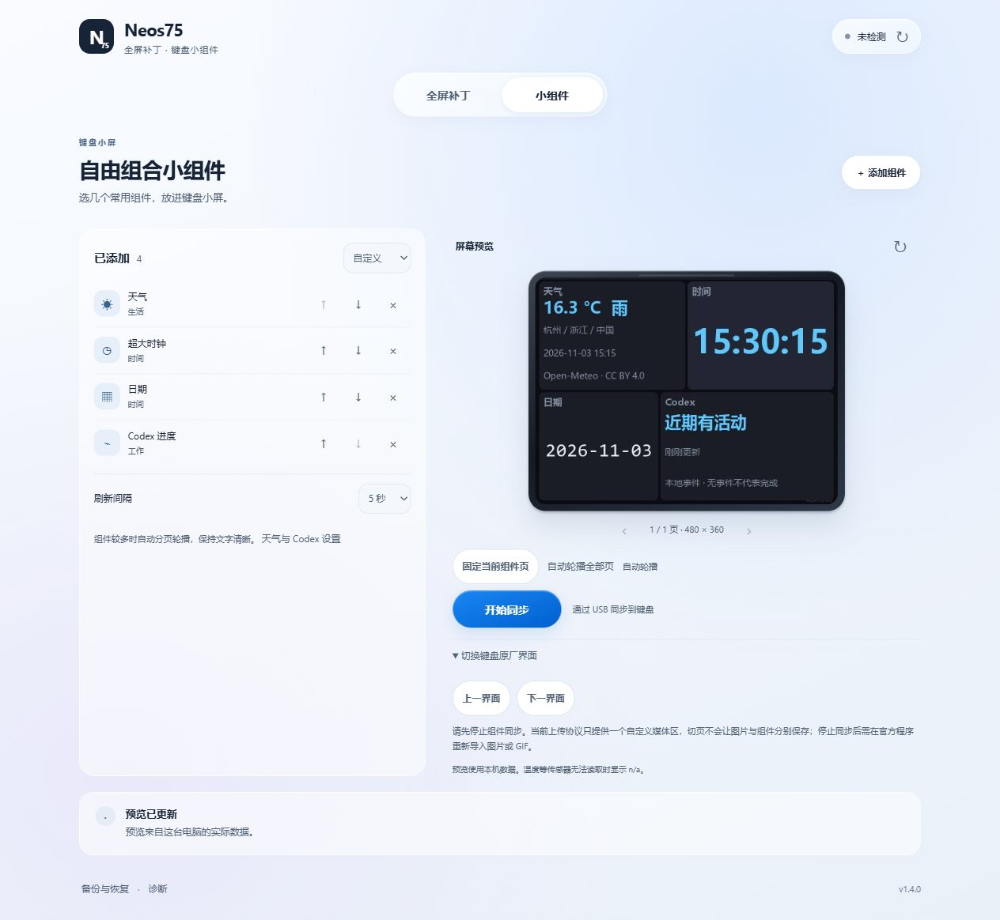

# v1.4.0 交付复盘与后续风险

本次交付天气、Codex 状态、组件页固定/轮播及原厂前后翻页入口。保留原来的全屏补丁链与自动备份流程，没有增加 MCU 改写，也没有自动刷写设备。

上图来自真实本机界面、天气接口和 Codex 事件源；杭州是测试选择的城市。屏幕预览不是键盘真机显示的验收照片。

## 已验收

- 本地 86 项 Python 测试及 7 组 Node 测试通过；天气城市选择、断网缓存、过期数据、明确任务事件和分页切换有针对性检查。
- 四平台构建 [41596366216](https://github.com/hacker1232345/neos75-fullscreen/actions/runs/41596366216) 全部通过，包括冻结程序版本 1.4.0、自带运行环境、真实 WebView 启动、17 项组件绘制及无确认写入拒绝检查。
- 浏览器实测城市搜索、真实天气渲染、Codex 状态、固定页、375px 窄窗口、无效任务 ID 提示、Escape 关闭与焦点返回。
- 原厂翻页只做官方报文对照、校验和、确认门与模拟 HID 应答测试，未做真机翻页验证。

## 复盘

官方的六个界面与电脑生成的组件页属于不同层次。当前图片上传协议没有目标页编号，仍使用一个自定义媒体区；本版不能将原图片/GIF与组件分别保存在不同的原厂页面。界面和发布说明直接标明这一限制。真正独立存储需要进一步定位 MCU 的页面对象、独立缓冲与绘制入口，并逐固件验证内存、恢复路径和实体切页行为。

Codex 的本地事件日志不是稳定接口。本版只显示可确认的状态，不根据无输出时间推断成功，不虚构完成百分比。超大记录等情况下显示“近期有活动”或未知；需要稳定外部事件接入时，可使用说明中的本地事件桥。

## 后续风险（按后果与发生可能性排序）

| 风险点 | 触发条件 | 后果 | 前兆 | 对策 |
| --- | --- | --- | --- | --- |
| 同一媒体区覆盖 | 开始组件同步 | 原图片/GIF被组件替换 | 同步前确认提示 | 停止后由官方程序重导入；独立槽尚未实现 |
| Codex 状态不完整 | 日志格式变化、远程任务或超大记录 | 只能显示活动或未知 | 没有明确事件、更新时间变旧 | 不推测完成；需要时接入官方事件桥 |
| 原厂翻页待真机验证 | 点击上一/下一界面 | 可能未切到预期界面 | 只收到协议应答 | 停止同步后实机确认；不把应答当显示成功 |
| 天气延迟或断网 | 公共接口不可用、模型更新较慢 | 当前温度无法及时更新 | 缓存标记、数据时间变旧 | 显示时间，超过一小时隐藏旧温度 |
| Mac/Linux 硬件差异 | 对应系统进行 USB/DFU 操作 | 权限或硬件兼容问题 | 设备不可见、协议超时 | 按平台说明处理；CI 不能代替真机验收 |

数据源、事件桥格式与使用限制见 [组件数据源说明](widget-sources.md)，下载与功能范围见 [v1.4.0 发布说明](release-v1.4.0.md)。
