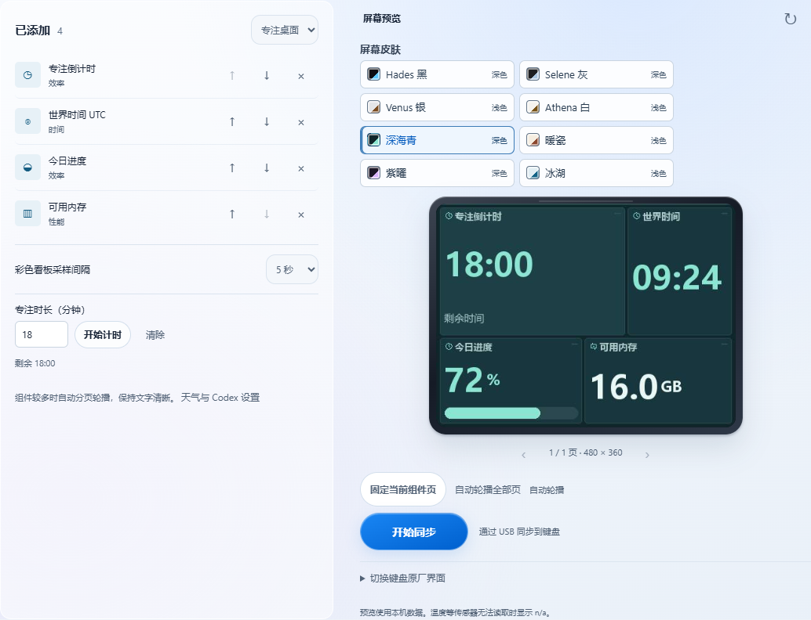
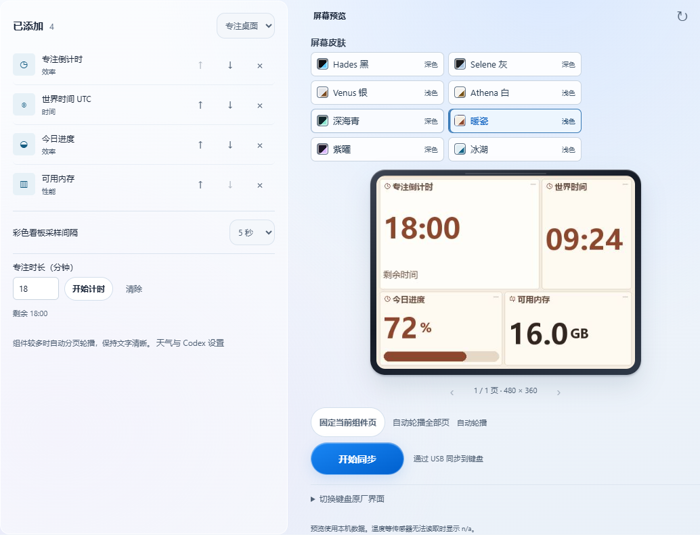

# NEOS75 小屏工作台 · 1.11.0-preview.1

在 1.10.0 基础上重新排版彩色组件，保留原部件和原皮肤 ID。新版桌面工具本身无需刷写固件；使用原生文字需要设备已有兼容补丁。

| 深海青 | 暖瓷 |
| --- | --- |
|  |  |

上图使用固定样本供界面对比。实际运行由本机采样，取不到的传感器不会补造数值。

## 新增部件

- **专注倒计时**：桌面版选中该部件后，设置 1～90 分钟并开始。剩余时间以单调时钟计算，跨刷新保持，关闭程序后重置。计时结束显示「时间到」，不会弹通知或响铃。
- **世界时间 UTC**：适合跨时区对表，按分钟显示。
- **今日进度**：按本地时钟的 24 小时刻度计算，午夜归零。
- **可用内存**：显示系统报告的当前可用物理内存，包含可回收缓存。
- 「专注桌面」预设将上述四项放在同一屏，四项均有原生 ASCII 格式。原有的时钟、硬件监控、日历、媒体、天气等继续可用。

## 如何使用静态底图和差分文字

1. 打开「小组件 → 静态底图与实时文字」，选择石墨蓝或深海青，点「保存 JPEG」。也可直接使用 [石墨蓝](../examples/native-bases/NEOS75-Graphite.jpg) 或 [深海青](../examples/native-bases/NEOS75-Tide.jpg)。
2. 停止彩色看板同步，在 A HUB 自定义媒体页导入 JPEG。回到键盘的该页（常见是第 5 页，以实际界面为准），在桌面工具只勾选该页。
3. 选择想显示的数据，点「连续发送」。建议先选「专注桌面」或精简到 3～4 个部件。文字白色，四行，每行最多 31 个 ASCII 字符。浅色皮肤用于彩色看板。
4. 停止或取消文字覆盖时，底图仍是当前自定义媒体；可重新用 A HUB 导入其他图片或 GIF。

| 模式 | 发送策略 |
| --- | --- |
| 彩色看板 | 逐字节相同的 JPEG 在短时间内跳过；画面变动仍上传整帧。每 30 秒到期后允许重传，补偿上传缺乏最终显示确认。 |
| 单页原生文字 | 首轮/定期全刷 5 次 HID 请求（1 次探测 + 4 行），只变一行 2 次，只变两行 3 次，完全相同 1 次探测。每个主机发送 report 65 B；一行变化的常态是 325 → 130 B（不含 ACK，模拟传输，不是实机时延）。 |
| 多页原生文字 | ACK 不包含页号，每次写完整四行；错误、重开或改页掩码后重新同步。单页达到 8 秒后的首个采样周期全刷，以兼容固件的闲置超时。 |

官方媒体协议没有已验证的局部写块接口，电脑缓存底图不会让彩色 JPEG 分层。现有原生文字补丁提供的是在常驻图片上绘制四行标签的路径。

## GIF 原画与成品

见 [哈迪斯动图与原画](../examples/hades/README.md)。本机只读查询返回 480×360 和 520,192 B 媒体空间。三份 GIF 均为 480×360、约 4 秒、10 帧、循环播放，文件约 342～406 KiB。已完整离线解码；A HUB 可能重编码，仍需上机确认导入及连续播放。

## 同类项目参考与后续方向

- [QMK OLED 驱动](https://docs.qmk.fm/features/oled_driver)追踪变动块；本项目用现有文字协议追踪变动行。彩色局部刷新仍需要 NEOS75 侧可验证的协议和绘制接口。
- [SteelSeries GameSense](https://github.com/SteelSeries/gamesense-sdk/blob/master/doc/api/sending-game-events.md)用事件驱动屏幕文本。可把播放器状态、计时完成、下载完成做成短提示，只显示状态，避免暴露聊天正文。
- [ZMK 显示部件](https://github.com/zmkfirmware/zmk/tree/main/app/src/display/widgets)提供电池、层、输出和打字速度等。NEOS75 可先验证键盘自身的电量、模式和锁定状态是否可读；如果要做打字速度，优先用固件聚合计数，避免电脑端捕获输入内容。当前「电池」仍是电脑电池。

## 复盘与后续风险

保留两条显示通道是关键：彩色通道负责主题、图表和中文，原生通道负责低流量文字。对行缓冲以 32 字节（含结尾）为兼容下限。硬件只做了媒体能力只读查询；增量 HID 由模拟设备回归测试，底图层叠和 GIF 真机播放待验收。

验证：Python 测试 165 项（通过 150 项，环境相关跳过 15 项）、Node 测试、Chrome 1130/375 px 的键盘交互与深浅预览、Windows x64 打包自检及原生 WebView 冒烟测试均完成。

| 风险点 | 触发条件 | 后果 | 前兆 | 对策 |
| --- | --- | --- | --- | --- |
| 底图被替换 | 彩色看板和底图使用同一个自定义媒体槽 | 丢失当前底图 | 屏幕出现彩色看板 | 启动文字同步前停止彩色同步；保留本地底图并按需重新导入 |
| 不支持原生文字 | 当前设备构建没装兼容补丁，或不在选中页 | 文字无法叠加 | 检查设备不就绪或回 FD | 用有线连接并确认选中实际媒体页；确认固件兼容后再考虑刷写 |
| GIF 重编码超空间 | A HUB 上传时逐帧转换，或设备媒体区不同 | 导入被拒、卡帧 | A HUB 提示过大，或只显示第一帧 | 先试体积最小的「钴蓝冷光」；必要时用更少帧或 PNG |
| 原生文字出现旧行 | 快速翻页、USB 出错或系统休眠 | 短暂出现旧内容 | 本轮写入失败或显示等待 | 单页优先；错误后重新全发，多页始终全发 |
| 文字能力有限 | 部件需要中文、图形、更多行或较长内容 | 内容被略过或缩短 | 文字预览出现空白或省略数量 | 用彩色看板显示中文与图表，或减少文字部件 |
