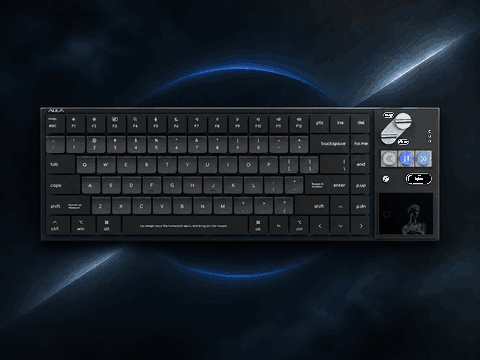
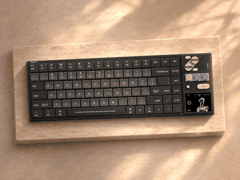
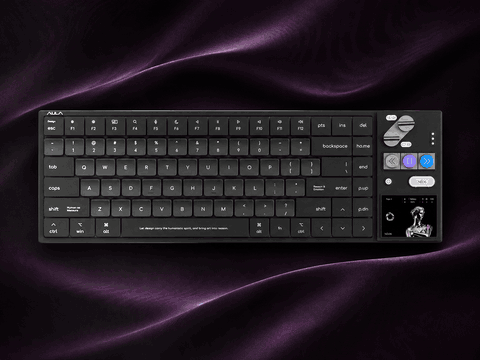

# 哈迪斯 · 三种光影

基于[狼蛛 NEOS75 官网哈迪斯配色图](https://www.aulacn.com/index/index/product?goods_id=136)创作；三张 PNG 是生成原画。GIF 中键盘本体保持固定，变化来自光影。图片属于艺术演绎，键帽小字不作为产品实拍或产品规格依据。

| 钴蓝冷光 | 香槟石纹 | 紫绸微光 |
| --- | --- | --- |
|  |  |  |
| [GIF](Hades-Cobalt.gif) · [原画 PNG](Hades-Cobalt.png) | [GIF](Hades-Travertine.gif) · [原画 PNG](Hades-Travertine.png) | [GIF](Hades-Silk.gif) · [原画 PNG](Hades-Silk.png) |

GIF：480×360，10 帧 / 4 秒，无限循环。需用 A HUB 导入，原厂未扩展时可能只显示在 320×320 区域；导入兼容性待实际设备确认。
